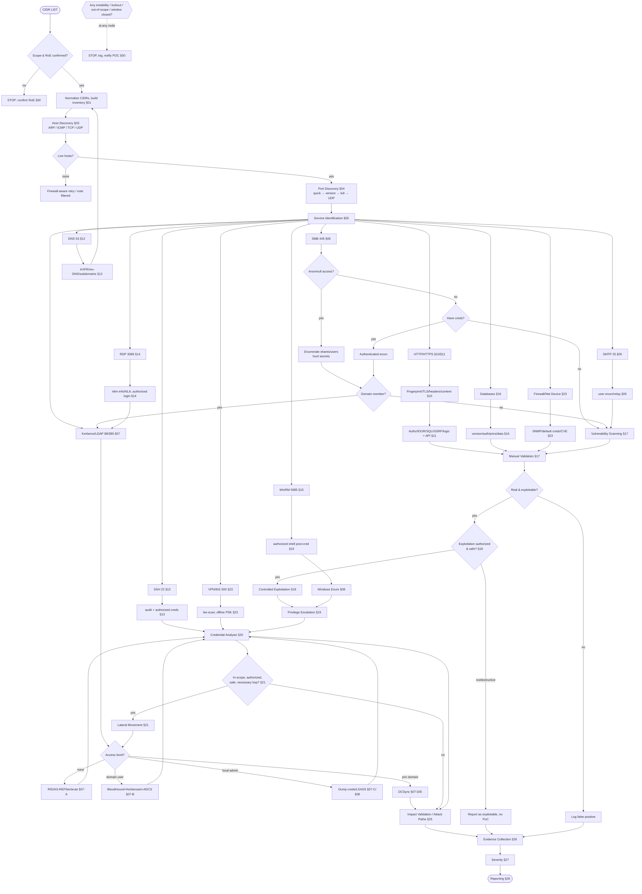

# 29 — Master Decision Tree

One tree from CIDR list to reporting, with every major service branch converging on the common
validation→exploitation→impact→evidence→reporting spine. Read it top-down; each service node links
to its chapter.

**How to use it:** you're always somewhere on this tree. Identify your current node, read its
decision diamond, follow the branch, land in the linked chapter. Every branch eventually reaches
the **common spine**: Validation → Exploitation decision → Privesc → Credentials → Lateral/Impact →
Evidence → Severity → Reporting. The global STOP applies at every node.
