# 36 — Mermaid Diagrams

Decision-oriented diagrams per methodology area. The single master tree is in §29; these are the
per-domain drill-downs. Each uses IF/ELSE decision diamonds.

## 36.1 Master methodology (condensed)
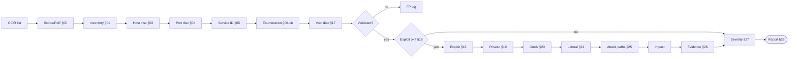

## 36.2 External pentest
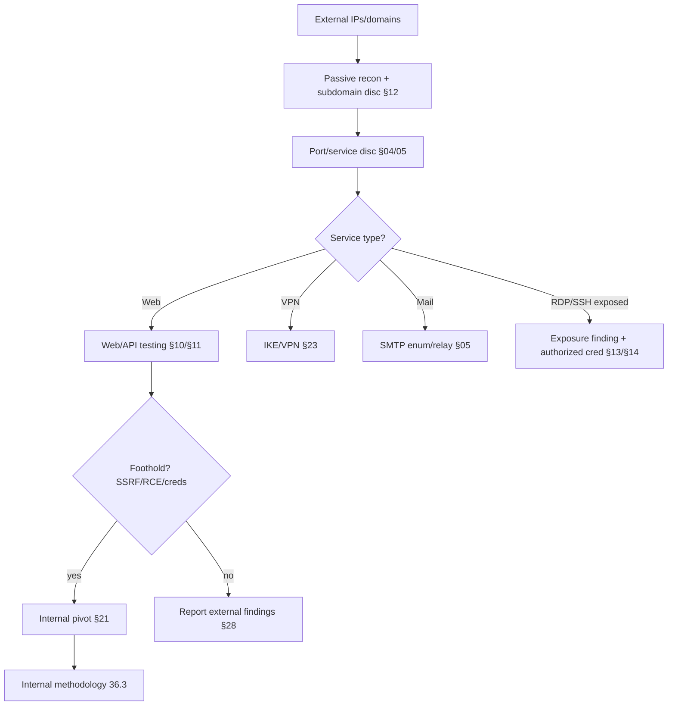

## 36.3 Internal pentest
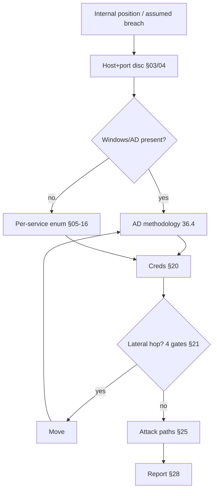

## 36.4 Active Directory
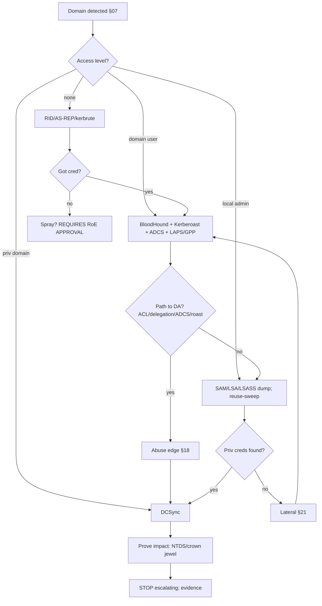

## 36.5 Windows host
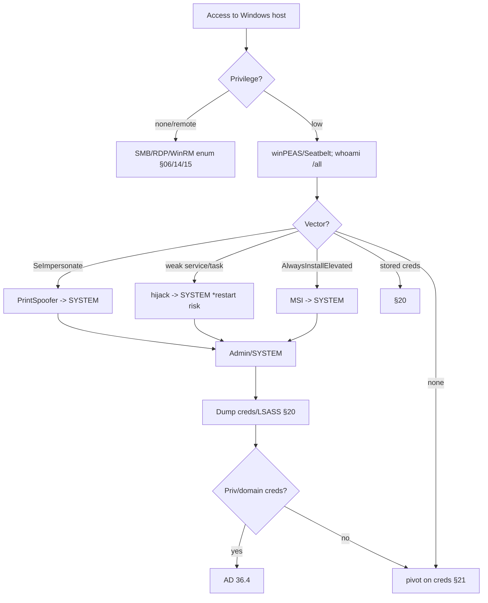

## 36.6 Linux host
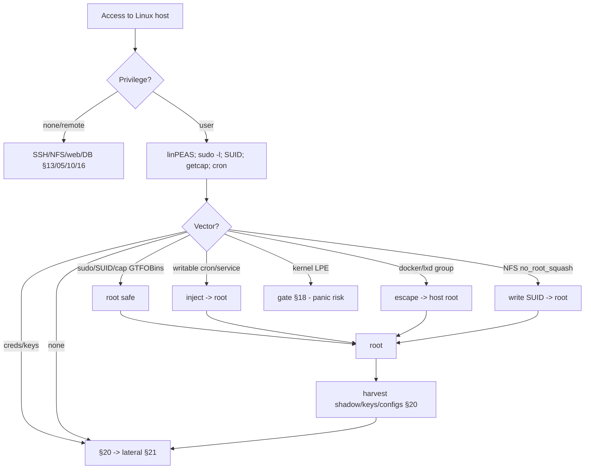

## 36.7 Web application
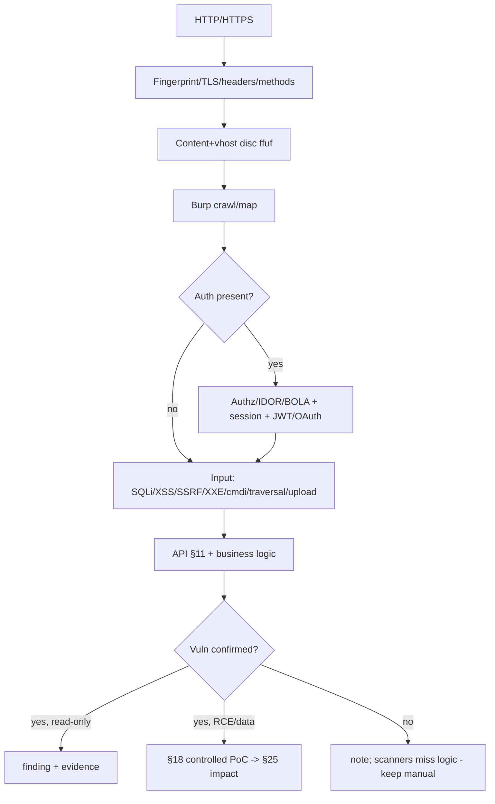

## 36.8 API
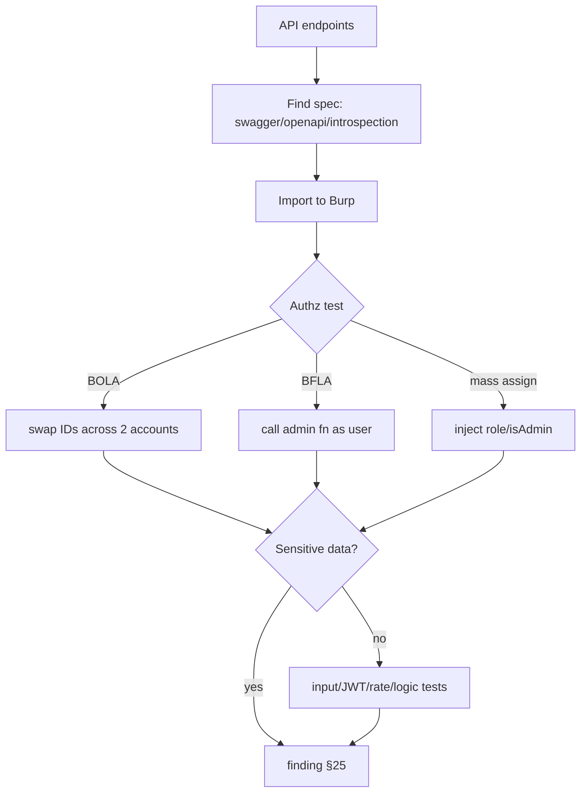

## 36.9 Credential attack path
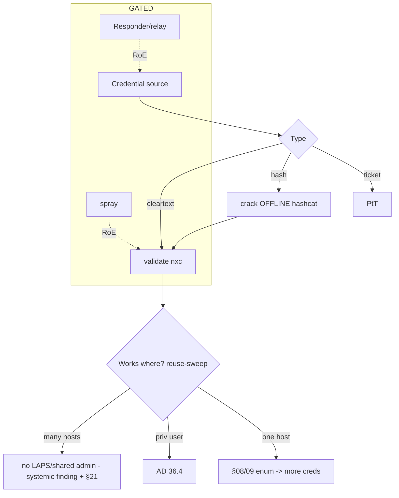

## 36.10 Lateral movement
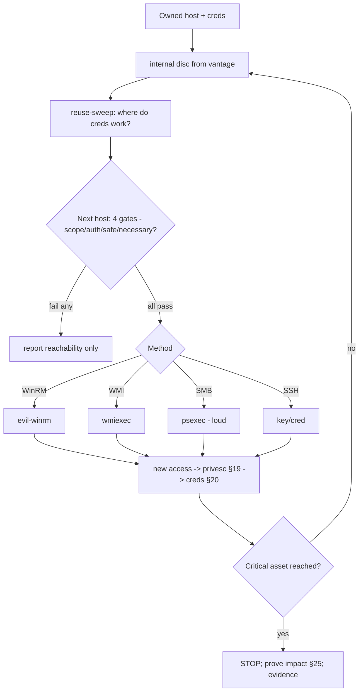

## 36.11 Network segmentation
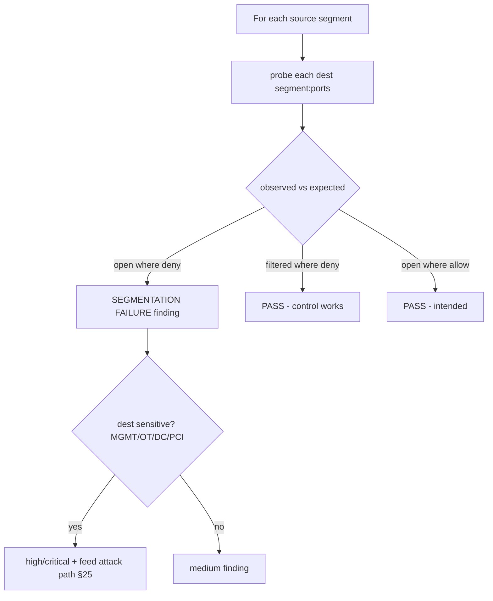

## 36.12 Vulnerability validation
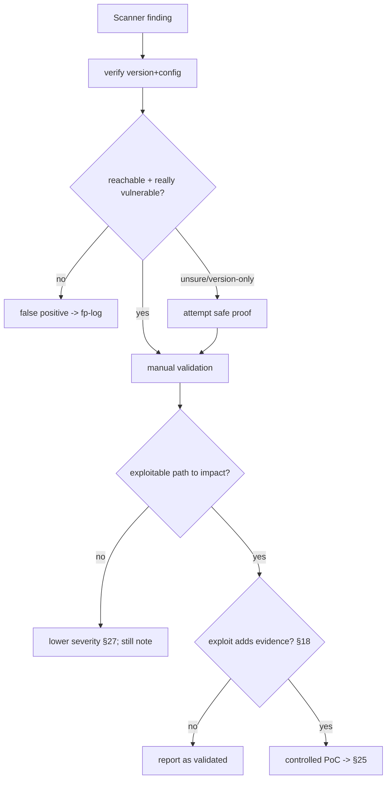

## 36.13 Evidence & reporting
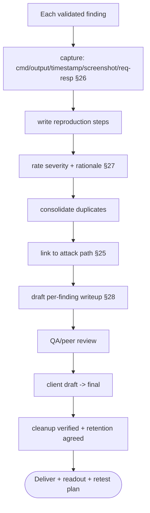
